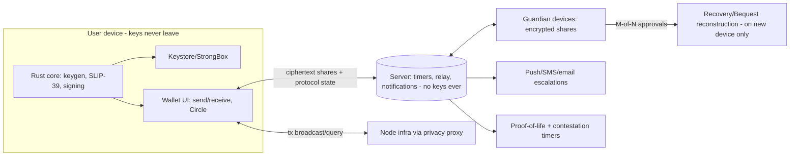

# Keyfob — a wallet your family can survive

Crypto's dirty secret isn't volatility — it's mortality. An estimated one-fifth of all Bitcoin is stranded forever in wallets whose owners lost keys or died without a plan, and every "not your keys, not your coins" lecture ends with a twelve-word phrase taped inside a book that will one day be sold at an estate sale. Keyfob is a self-custody wallet built around the two catastrophes that actually destroy family wealth: losing your keys, and dying without a plan. Recovery through people you trust. Inheritance through a protocol, not a shoebox. And every cryptographic concept explained in words your parent can follow — because a security model your family can't understand is a security model that fails exactly when it matters.

## 1. Overview
- **Elevator pitch:** A self-custody crypto wallet where social recovery and inheritance are the core product, not settings: Shamir secret sharing across chosen guardians with rotation ceremonies, a proof-of-life dead-man's-switch that releases access to designated heirs after a contestable waiting period, and plain-language security throughout. Non-custodial always — Keyfob can't touch funds, which is the point and the compliance posture.
- **Category:** Finance — crypto wallet (self-custody).
- **Tagline:** *A wallet your family can survive.*
- **Play Store positioning:** "The first wallet designed for the day you lose your keys — and the day your family loses you."

## 2. Problem & Why Now
Self-custody has a fatal UX flaw at each end of life. At the front: seed phrases are a 2009-era ritual that normal humans provably cannot perform safely (Chainalysis-cited estimates put ~20% of BTC as lost/stranded; every crypto forum is a graveyard of "lost my phrase" threads). At the back: crypto inheritance essentially does not exist as a product — the practical state of the art is "tell your spouse where the metal plate is," which fails against divorce, house fires, memory, and the plain fact that most heirs couldn't operate a hardware wallet under grief. Meanwhile the enabling pieces matured: **Shamir secret sharing** is battle-tested (SLIP-39 standardizes it; Trezor ships it), account-abstraction and multisig patterns normalized "keys held in more than one place," and — decisively for a consumer app — the *demographics shifted*: the 2013–2017 adopter cohort is now 35–55 with families, mortgages, and estate-planning instincts, and holds the majority of self-custodied value. Estate attorneys report crypto questions rising every year with nothing to recommend. The wallet market competes on tokens, swaps, and NFT tabs; nobody owns "the responsible one." That position is empty, durable, and exactly what the next decade of aging holders needs.

## 3. Target Audience & Personas
- **Sanjay, 42, engineering director, Austin.** Six figures across BTC/ETH from early days, currently split between a Ledger in a drawer and Coinbase. Two kids. His will mentions crypto in a vague clause his attorney admitted she couldn't operationalize. Keyfob's inheritance protocol is the first thing that maps to how he thinks about his 401(k) beneficiaries. He migrates the Ledger's holdings over a weekend, names his wife and brother as heirs, his brother and two friends as guardians.
- **Ruth, 58, dentist, Manchester.** Bought ETH in 2021, keeps it on an exchange because self-custody terrifies her — specifically, *she* terrifies her ("I lose passwords weekly"). Guardian recovery is the unlock: her two adult children and her sister hold shares; no single point of failure is *her memory*. She's the mass-market future of self-custody, and no current wallet is built for her.
- **Miguel, 34, estate-planning attorney, Miami (the multiplier).** Doesn't hold much crypto; *advises* people who do. Keyfob's attorney-facing explainer pack and the heir-education flow make it the first wallet he can professionally recommend. Every Miguel is worth a hundred installs of exactly the right users.

## 4. Core Concept Deep-Dive
**Security model in one sentence per layer, because explainability is a security feature.** Keyfob is a non-custodial wallet whose master key is generated on-device and can be reconstructed only by M-of-N Shamir shares distributed to guardians the user chooses. The app's whole interaction language enforces comprehension: every cryptographic action has a "what this really means" line at an eighth-grade reading level, and irreversible actions require passing a two-question comprehension check (not a scroll-wrapped EULA — literally "Which of these can Keyfob do if you lose everything? A) restore your money B) nothing without 3 of your 5 guardians." Get it wrong, get a gentler explanation. This sounds paternalistic and tests wonderfully; it is the product's soul: **a wallet that refuses to let you not understand it.**

**Guardians & recovery.** Setup: choose 3–7 guardians (people, plus optionally: a second device of yours, a printed share in a bank deposit box, or — for a fee — Keyfob's institutional co-guardian, which alone can never reconstruct anything). Each human guardian installs Keyfob (or the free Guardian companion), completes a verification ceremony (QR exchange in person or verified video call — the share binds to their device keystore), and holds an encrypted share that is *useless alone*. Recovery: new phone → "begin recovery" → guardians get notified → M approvals within the recovery window (each approval is its own mini-ceremony with liveness + the guardian personally contacting you out-of-band — the app *instructs* them to call you, making social engineering loud) → key reconstructs on the new device only. **Rotation ceremonies** run annually by default (guardians re-confirm, shares re-issue — catching dead phones, drifted friendships, and forgotten arrangements before they're needed; the calendar of custody is a product invention the space needed).

**Inheritance: the Bequest protocol.** The user designates heirs (with allocations across accounts), writes/records an optional legacy message, and sets the **proof-of-life cadence** (default: quarterly check-in, a 10-second app interaction; any wallet activity counts implicitly). Miss a check-in → escalating nudges over 30 days (push, email, SMS, guardian pings — the system tries hard to find you alive). Sustained silence → the **contestation window** opens (default 90 days, configurable): heirs and guardians are notified that transfer will proceed; *any* guardian or the user can halt it with one tap (traveling, imprisoned, hospitalized — the false-positive protections are the design's center). Only after silence survives contestation do heirs, with M-of-N guardian co-approval, reconstruct access — heirs never hold shares beforehand, guardians can never act without the protocol state, and Keyfob's servers orchestrate *messages and timers only*, never keys. The whole flow is rehearsable: **Fire Drill mode** simulates death end-to-end annually (heirs see a sandbox recovery; families report this drill as the moment crypto stopped being dad's weird hobby and became an estate asset — the drill is also the retention feature).

**Deliberate scope restraint:** BTC, ETH + major EVM chains, and stablecoins at launch. No swaps-as-revenue-center, no token casino, no NFT tab, no browser dApp circus (a WalletConnect signer exists, clearly fenced as "advanced"). Keyfob competes on trust, and every casino feature erodes the brand that Ruth and Miguel require. The threat-model page in-app says plainly what Keyfob defends against (loss, death, single-device compromise, phishing-by-urgency) and what it does not (a compromised phone during active use, coercion, guardians colluding at M — with honest guidance on choosing guardians who don't all know each other).

## 5. Complete Feature Set
**MVP (v1.0):**
- Wallet core: BTC + ETH/EVM + stablecoins; send/receive with address-book-first UX (free-typing an address is the *fallback*, not the default), human-readable transaction previews ("Send 0.1 ETH (~$412) to Mom — saved contact"), hardware-wallet import paths.
- Guardian recovery: SLIP-39-based Shamir shares, guardian ceremonies, M-of-N configuration with opinionated defaults (3-of-5), Guardian companion mode (free, lightweight), rotation ceremonies with calendar.
- Recovery flow with out-of-band verification choreography and velvet-rope delays (recovery completes no faster than 48h — speed is the attacker's friend, and the app says so).
- Comprehension-check system; plain-language layer; threat-model page.
- Fire Drill v1 (recovery rehearsal for the owner + guardians).
**v1.x fast-follows:**
- Bequest protocol: heirs, allocations, proof-of-life engine, contestation window, legacy messages (E2E-encrypted, released only on protocol completion), heir education flow ("what you'll need to do, someday" — readable today, actionable then), full Fire Drill with heir sandbox.
- Institutional co-guardian service; attorney pack (documentation templates that reference the protocol for wills/trusts, developed with estate counsel).
- Multi-device (a tablet as your own second guardian), watch-only mode for heirs/advisors.
**v2.0+:**
- Multisig vaults (2-of-3 owner keys for large holdings, guardians as recovery layer on top), inheritance for multisig.
- Stablecoin auto-yield via clearly-fenced, jurisdiction-gated integrations (revenue without the casino: conservative, disclosed, optional).
- Family plan: household dashboard where each member's guardian/heir graph is visible (with consent), shared drills.

## 6. Screen-by-Screen UX Walkthrough
Navigation: bottom bar — **Home**, **Send/Receive**, **Circle** (guardians/heirs), **Vault** (settings/security). The Circle tab existing at nav-level is the positioning statement.
- **Home:** balances (fiat-first display — "$14,730" big, tokens small; Ruth thinks in pounds), recent activity in sentence form, protocol status strip ("Guardians: 5 healthy · Next check-in: March · Last drill: 11 months ago — schedule one?").
- **Send:** contact picker → amount → the preview sentence → slide-to-send with a 10-second undo for first-time recipients; new-address sends get friction on purpose (checksum display, "call them and confirm the last 4 characters" nudge).
- **Circle:** the graph — you at center, guardians as a ring (health states: green/verified, amber/rotation-due, red/unreachable), heirs as an inner arc with allocations; every node tappable to its ceremony history. This screen is the app's brand image and demo centerpiece.
- **Guardian ceremony flow:** invitation → their companion install → the QR/video verification ritual (deliberately ceremonial — good ritual encodes seriousness; there is a moment where both parties hold the phones together and it *feels* like witnessing a document) → share issuance confirmation to both.
- **Bequest setup (v1.x):** heirs → allocations (percentage sliders with plain summaries) → cadence & windows with scenario explanations ("If you're in a coma for 5 months, here is exactly what happens, step by step") → legacy message recording → the comprehension check → guardian notification.
- **Recovery (new device):** sober, calm, step-listed; progress as guardians approve; the built-in "this is taking days by design" explanation.
- **Vault:** threat model, session security (biometrics, auto-lock), advanced fence (WalletConnect, network settings), export/documentation.
**Key flow — onboarding (the trust walk):** install → "Keyfob can never touch your money. Let's make sure nothing else can either." → create wallet (keys on-device) → *before any deposit prompt*: "Who's your first guardian?" — the app refuses to celebrate funding until recovery exists (a wallet that lets you deposit before securing recovery is selling you a cliff; inverting this order is Keyfob's loudest opinion) → first guardian ceremony (a second-device self-guardian allowed for instant start) → then funding paths (exchange transfer walkthroughs per major exchange, hardware import). 
**Key flow — the check-in:** quarterly push → open → FaceID → "Good to see you. Next check-in: June." Ten seconds, warm, done. Missed twice → a guardian gets a "maybe call Sanjay?" nudge — the system's escalations are human before they are cryptographic, which is both kinder and more secure.

## 7. Design Language
Bank-grade calm with human warmth — the visual opposite of crypto-casino: deep evergreen and off-black surfaces, a single brass accent (the key metal), zero neon, zero rockets. Type: a quietly authoritative serif for headings (like a trust company's letterhead rebuilt for screens) over a plain sans for data; numbers in tabular lining figures. The Circle graph gets the design investment: hand-tuned physics, portrait avatars, health states as gentle auras. Motion: deliberate and weighty — ceremonies have slow, confirmatory choreography; nothing in this app ever bounces. Illustration for education: warm line-drawn scenes (a family at a kitchen table, not vault doors and lightning bolts). Microcopy is the design system's core asset, drafted with the same banned-words discipline as Kith (banned: "to the moon," "degen," "ape"; required: sentences a worried 58-year-old finds calming). Haptics: the ceremony's witnessing moment has a synchronized dual-device pulse — the most considered haptic in this whole portfolio.

## 8. Technical Architecture
Opinionated stack: **Kotlin + Jetpack Compose**, with the crypto core in **Rust** (shared library; audited once, reused for a future iOS build): key generation/derivation (BIP-32/39 internally, SLIP-39 for share issuance), signing (BTC PSBT; EVM via alloy-style primitives), and the share/ceremony state machines. Keys live in **Android Keystore/StrongBox** where hardware allows, with the master secret existing in plaintext memory only during signing/ceremony operations (zeroized after; the architecture doc is public — see below). Guardian shares: encrypted to each guardian's device-bound keypair; the server relays *ciphertext and protocol state only*. Backend: a deliberately boring **Postgres + Rust (axum)** service — accounts optional (protocol participants need push identity), timers (proof-of-life, contestation), notification fan-out (push/email/SMS via Twilio), and nothing else; a public **transparency page** documents exactly what the server stores (no keys, no shares in plaintext, no balances — chain data comes from nodes via privacy-respecting proxies with user-configurable endpoints). Chain infrastructure: managed nodes (own-run bitcoind + reth long-term) behind a caching layer. **Two independent security audits before launch** (core library + protocol design) with reports published; a bug bounty from day one. Open-source the crypto core and protocol spec — for this product, verifiability is marketing.

## 9. Data Model
(Server-side; deliberately sparse.) 
- **Account:** `id`, `push_tokens[]`, `contact_channels{email?, sms?}`, `role_flags{owner|guardian|heir}`, `created_at`.
- **CustodyGraph:** `owner_id`, `guardians[{account_id, share_ciphertext_ref, verified_at, last_rotation, health}]`, `threshold_m`, `n`, `rotation_cadence`.
- **BequestPolicy:** `owner_id`, `heirs[{account_id, allocation_pct, education_state}]`, `checkin_cadence`, `missed_count`, `state{active|escalating|contestation|released|halted}`, `contestation_days`, `legacy_message_ciphertext_ref?`.
- **CeremonyLog (append-only):** `type{issuance|rotation|recovery_approval|drill|halt}`, `parties[]`, `at`, `attestations[]` — the family's custody history, exportable as the "estate documentation" PDF attorneys want.
- **ProtocolTimer:** `policy_id`, `kind{checkin|escalation|contestation}`, `fires_at`.
On-device: wallet accounts, tx cache, contact book, education progress — standard, encrypted at rest.

## 10. Monetization
Aligned with custody, not trading. **Free:** full wallet, up to 3 guardians (3-of-3 or 2-of-3), self-guardian devices, drills, all education. **Keyfob Complete — $4.99/month or $39.99/year:** up to 7 guardians with flexible M-of-N, rotation automation, the full Bequest protocol, legacy messages, attorney documentation pack, priority escalation channels (SMS in more regions), multi-device. **Institutional co-guardian — $2.99/month add-on:** Keyfob's HSM-held share (never sufficient alone, jurisdictionally separated, contractually bound to the protocol — the "my friends are flaky" solution). **One-time Estate Setup — $99:** white-glove onboarding call + attorney pack + first family drill facilitated (priced against the $400/hour estate-attorney alternative; also the gift SKU adult children buy for parents — watch that purchase pattern, it's the wedge into Ruth's cohort). Explicitly rejected: swap-fee skimming and token listings-as-revenue (the casino), and any custody of funds (the regulatory cliff). Unit logic: this is a high-LTV, low-churn subscriber base (canceling your inheritance protocol is not like canceling a meditation app), and 100k paying families ≈ $5M ARR without touching a single basis point of anyone's assets. Targets: 8% of funded wallets to Complete within 6 months; Estate Setup attach 3% of new funded wallets year one.

## 11. Play Store Listing
- **Title (≤30):** `Keyfob: Wallet & Inheritance` (28)
- **Short description (≤80):** `Self-custody crypto with guardian recovery and a real inheritance plan.` (71)
- **Full description:** open with the stranded-fifth statistic and the shoebox; blocks: Your Keys, Actually Recoverable (guardians, ceremonies, no single point of failure), The Plan Your Family Deserves (Bequest, proof-of-life, contestation, drills), Built to Be Understood (comprehension checks, threat model, plain language), Verifiable Restraint (open core, audits published, what our server can never see), What We Don't Do (no swaps-casino, no tokens, no custody). The "what we don't do" block is unusual and is the listing's sharpest conversion tool for this audience.
- **ASO keywords:** crypto wallet inheritance, bitcoin wallet secure, social recovery wallet, self custody wallet, crypto estate planning, seed phrase alternative, shamir backup, bitcoin for family, ethereum wallet safe, crypto beneficiary.
- **Content rating:** Everyone.
- **Policy notes (load-bearing):** Google Play's cryptocurrency policies require exchange/wallet apps to be properly declared — complete the **Financial Features declaration**, register as a non-custodial wallet, and restrict availability to permitted regions per current policy; no mining on device; ads absent (also policy-relevant for financial apps); Data safety must reflect the transparency page exactly; regional gating reviewed with counsel at each expansion (self-custody software avoids most licensing regimes *because* it never touches funds — preserving that property is a standing legal constraint on every feature).

## 12. Growth & Marketing Plan
Trust compounds through professionals and proof. (1) The attorney channel: Miguel is the strategy — CLE-style webinars on crypto estate planning, the documentation pack, a directory of "Keyfob-fluent" attorneys (they ask to be listed; it brings them clients); estate-planning conferences over crypto conferences, deliberately. (2) The published-audit launch: security reports, open core, and the transparency page make the launch story "the wallet that shows its homework" — aimed at Bitcoin/ETH podcasts and newsletters whose hosts are aging into exactly this need (many have publicly fretted about inheritance; pitch them personally). (3) The Fire Drill as content: real families running inheritance drills is documentary-grade material (with consent, anonymized variants) — nothing in crypto marketing looks like it, because nothing in crypto is built for it. (4) Adult-children gifting motion: "help your parents self-custody safely" content for the holidays; the Estate Setup SKU is its call to action. (5) Exchange-exodus moments: every custodial scare (freezes, hacks, bankruptcy news) drives self-custody searches — prepared comparison content ("leaving Coinbase, but safely") captures them with the responsible option; this is the category's recurring free marketing and it will recur. Community: a guardians' FAQ hub, because every user recruits 3–7 *non-crypto* people — the guardian education content is secretly the biggest onboarding surface in the product.

## 13. Analytics & KPIs
North star: **funded wallets with ≥3 verified guardians** (custody actually secured — installs are vanity here). Key events: `wallet_created`, `first_guardian_verified{days_from_install}`, `guardian_count_reached{3}`, `funding_received{source: exchange|hardware|onchain}`, `rotation_completed`, `checkin_done{seconds}`, `drill_completed{participants}`, `bequest_configured`, `heir_education_completed`, `complete_started{trigger}`, `estate_setup_purchased{buyer: self|child_gift}`, `recovery_initiated/completed{duration}`, `halt_used`. Thresholds: guardian-before-funding order preserved for ≥ 80% of funded wallets (the loudest opinion, measured); 3-guardian rate ≥ 60% of funded; annual rotation completion ≥ 70%; check-in response within 7 days ≥ 95% (the protocol's false-positive hygiene); drill participation ≥ 40% of Bequest users annually; recovery success rate = 100% with median duration 3–5 days (fast enough to save, slow enough to be safe); support tickets mentioning "confused" trending to zero as the comprehension system tunes.

## 14. Risks & Mitigations
- **A recovery or bequest fails when it matters (the existential risk):** protocol simplicity over cleverness, two audits, the drill system (rehearsed systems fail less), ceremony logs for debuggability, and staged rollout of Bequest behind long beta with simulated-time testing harnesses (timers are where bugs hide; property-test the state machine exhaustively).
- **Social engineering of guardians:** out-of-band call choreography, velvet-rope delays, guardian education (the FAQ hub is a security control), M-of-N thresholds defaulted so no two colluders suffice, and recovery notifications blasted to *all* devices and channels of the owner.
- **Regulatory drift (non-custodial lines move):** counsel on retainer; region gating infrastructure from day one; the no-custody, no-swap-revenue posture minimizes surface; monitor Play's financial-policy updates as a standing release-checklist item.
- **"Boring wallet" growth ceiling vs. casino wallets:** accepted strategically — the moat *is* the restraint; growth borrows urgency from custodial failures and demography rather than token cycles (and survives bear markets better for it).
- **Guardian app abandonment (dead companion installs):** rotation ceremonies surface dead guardians annually; health monitoring pings quarterly; the institutional co-guardian is the backstop product.
- **Key extraction from compromised devices:** StrongBox where available, session hygiene, plaintext-lifetime minimization, and honest threat-model communication (Keyfob never claims to defeat a rooted phone).

## 15. Competitive Landscape
- **MetaMask / Trust / Coinbase Wallet (the incumbents):** token-forward, dApp-forward, casino-adjacent; recovery = seed phrase lectures; inheritance = nothing. Keyfob doesn't compete for their daily-trader user — it competes for that user's *net worth at 45*.
- **Argent / Safe{Wallet} (social recovery pioneers):** validated guardians on-chain (Argent's guardians, Safe's multisig); EVM-centric, DeFi-power-user framed, no inheritance protocol, no plain-language mission; Safe is infrastructure Keyfob may build multisig vaults *on*, not against.
- **Casa:** the premium standard for multisig custody + inheritance planning ($250–$5,000/year, concierge, BTC-first) — proof the top of this market pays richly; Keyfob is Casa's model democratized to app price points and Ruth's device.
- **Trezor/Ledger + metal plates (the hardware ritual):** solves device compromise, punts recovery/inheritance to shoeboxes; Keyfob integrates hardware as an import/companion rather than fighting it.
- **Exchange "beneficiary" features & custodial inheritance:** the custodial answer (Coinbase's estate process is paperwork-after-death); real, but requires trusting a company's solvency and support queue with your family's money — Keyfob's founding counter-position, stated respectfully in comparison content.

## 16. Development Plan
Small team required (this is the portfolio's one non-solo project: 2 engineers + counsel + auditors minimum; shipping a custody protocol solo would be malpractice) — ~34 weeks to v1.0. W1–4: Rust core (keys, SLIP-39, signing) with test vectors against reference implementations; threat-model doc drafted *first* and reviewed externally. W5–8: wallet basics (BTC/EVM send/receive, node infra, previews-as-sentences). W9–14: guardian system — ceremonies, share issuance/rotation state machines (property-tested), Guardian companion, recovery choreography with simulated-time harness. W15–17: comprehension-check framework, education layer, Circle UI. W18–20: Fire Drill v1; transparency page; open-source release prep. W21–26: **audit window** (two firms, staggered; fix cycles) — feature work pauses except polish; this is scheduled, not hoped-for. W27–30: closed beta with 50 families end-to-end (real guardians, real rotations, one staged recovery each); Estate Setup concierge prototyped by founders personally (do things that don't scale, learn the family dynamics). W31–33: Play financial declarations, regional gating, store assets, launch content with published audits. W34: launch. Bequest ships as v1.x only after six months of guardian-system field data — inheritance rides on proven rails or not at all. **If behind:** cut multi-device and the institutional co-guardian to post-launch — never cut audits, the comprehension system, or recovery delays.

## 17. Moonshots
- **The open Bequest standard:** publish the inheritance protocol as an open specification other wallets implement — Keyfob as the reference client of *the* standard (the Patchwork-federation instinct applied to death; whoever writes this standard defines the category).
- **Jurisdiction bridges:** partnerships making ceremony logs + attorney packs directly admissible/executable in probate workflows (starting with common-law jurisdictions) — the day a court accepts a Keyfob ceremony log as evidence of intent, the product category changes.
- **Beyond crypto:** the guardian/heir/proof-of-life rails generalize to *all* digital assets — password vaults, 2FA seeds, encrypted archives ("the last feature" from Sentence, industrialized); Keyfob as the custody layer for a digital life, not a coin.
- **Institutional guardian network:** credit unions and community banks as regulated co-guardians (they crave relevance; families trust them locally) — a B2B2C channel that also answers "what if all my guardians predecease me."
- **The hundred-year test:** an endowed, legally chartered continuity foundation guaranteeing protocol operation independent of the company's fate — custody software that outlives its maker, which is, in the end, the only honest version of this promise.
